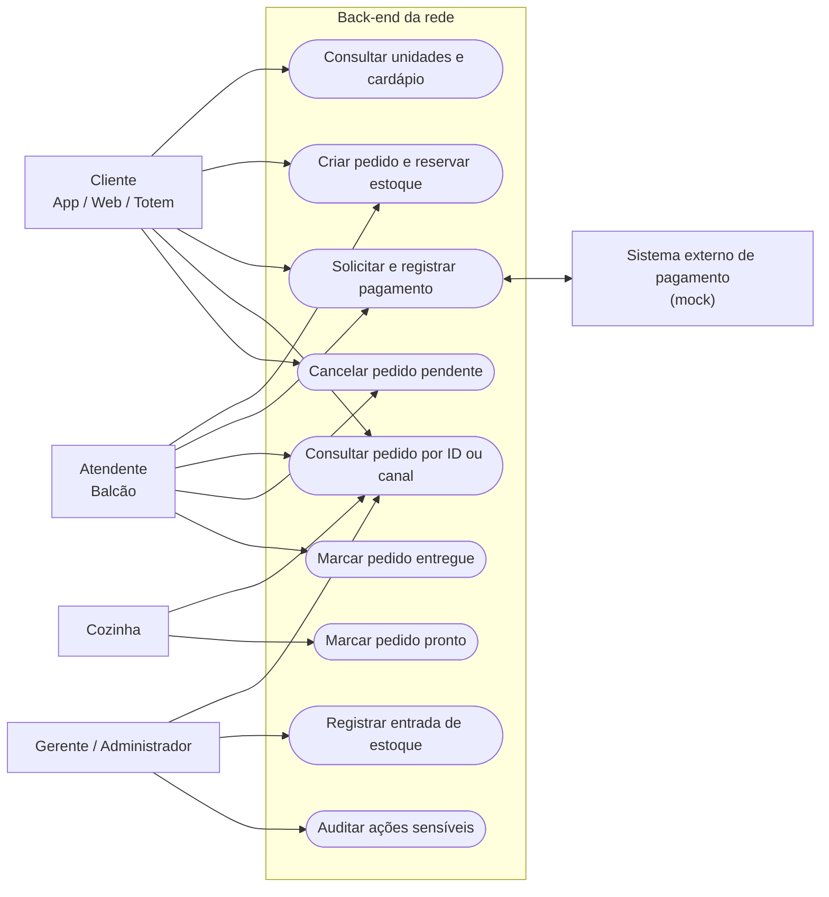
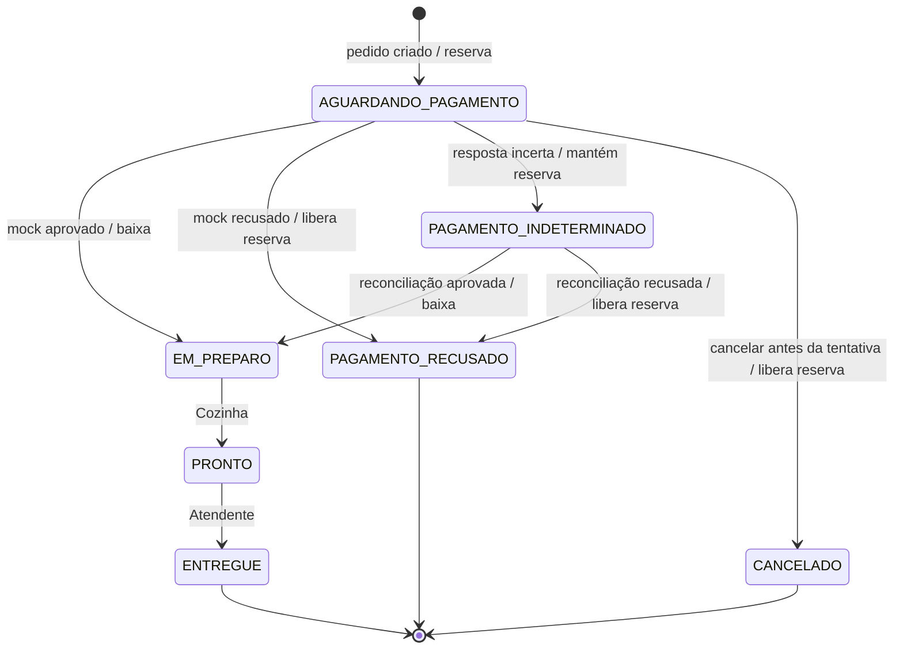
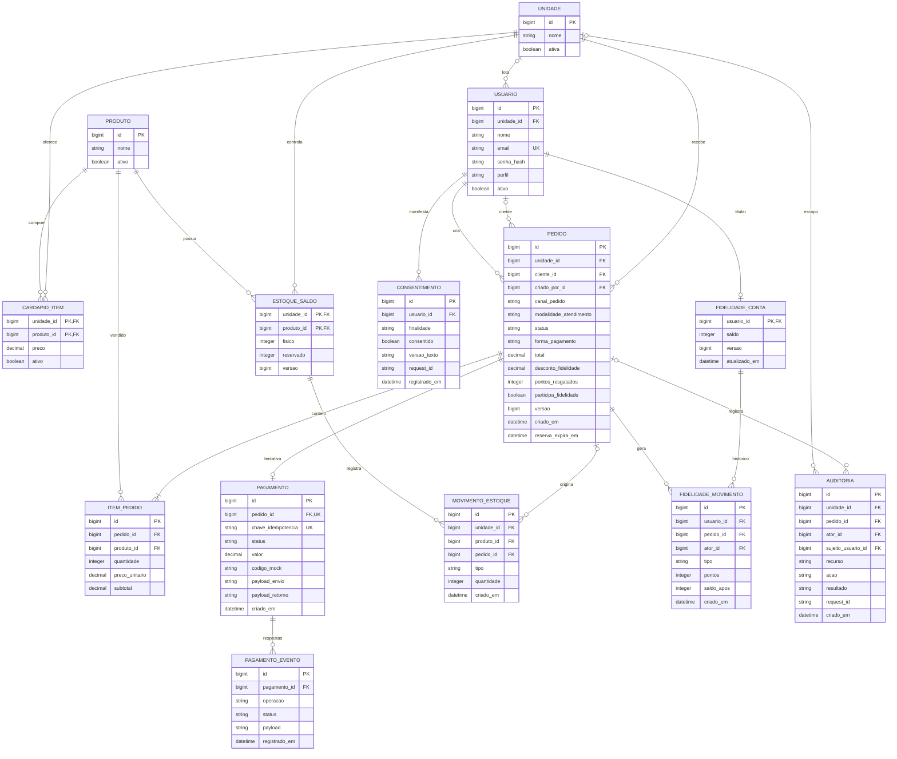
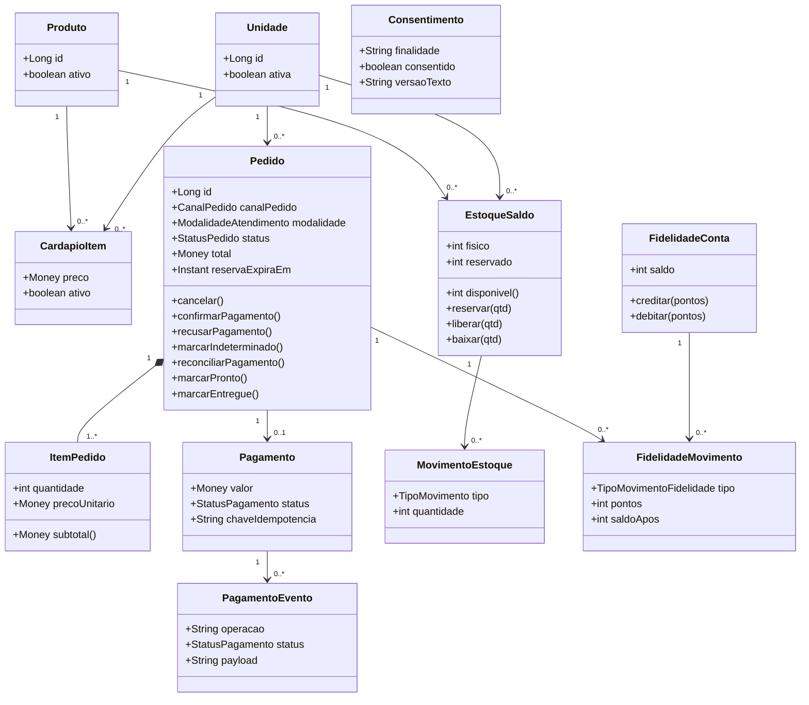
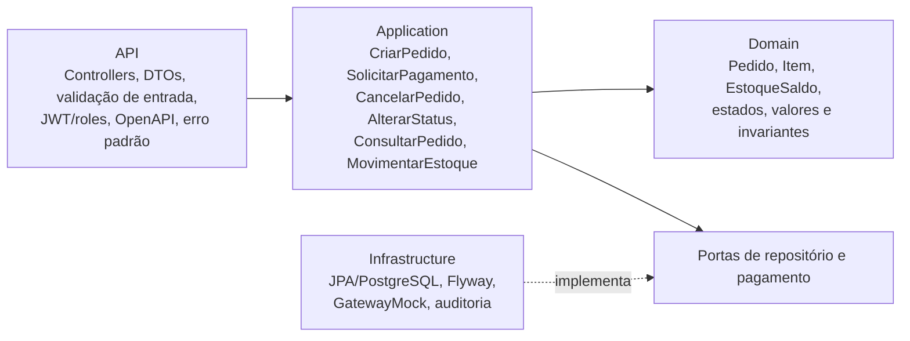

# Etapa 02 — modelagem do Fluxo A

Base: matriz e decisões da etapa 01; roteiro Back-End, páginas físicas 5–13. Este documento é um **projeto de domínio e contratos para a tarefa 03**, não uma afirmação de implementação. Stack alvo: Java 21, Spring Boot 4.1.x, Maven, PostgreSQL local, Spring Security, JPA e Flyway; sem Docker/Testcontainers.

**Revisão da etapa 07:** resultado técnico indeterminado retém a reserva até reconciliação. A interface de pagamento e o histórico de eventos foram incorporados ao modelo abaixo; `PAGAMENTO_FALHOU` permanece no esquema como estado legado, sem nova transição para ele.

**Revisão da etapa 08:** o programa de fidelização passou a integrar o fluxo executável. Consentimento específico (`CONSENTIMENTO`, finalidade `FIDELIDADE`) é registrado e revogável pelo `CLIENTE`; pedidos anônimos ou criados sem consentimento vigente não participam (`participa_fidelidade = false`, `pontos_resgatados = 0`). O saldo fica em `FIDELIDADE_CONTA` e é integralmente explicado pelos lançamentos de `FIDELIDADE_MOVIMENTO` (`ACUMULO`, `RESGATE`, `ESTORNO_RESGATE`), com unicidade por `(pedido_id, tipo)`. A taxa de acúmulo é **1 ponto por R\$ 1,00 inteiro pago** quando o pedido atinge `ENTREGUE` (e o consentimento permanece ativo); o resgate ocorre em **blocos de 100 pontos = R\$ 5,00** de desconto na criação de pedido posterior, limitado a **50% do subtotal dos itens**. Recusa de pagamento, cancelamento pré-pagamento ou expiração de reserva estornam automaticamente os pontos resgatados uma única vez.

**Revisão da etapa 09:** a tabela `AUDITORIA` passou a registrar explicitamente `unidade_id` (`V11__auditoria_unidade_e_indices.sql`) junto a `ator_id`, `sujeito_usuario_id`, `pedido_id`, `recurso`, `acao`, `resultado`, `request_id` e `criado_em`, viabilizando consulta paginada e autorizada por unidade para `GERENTE` e global para `ADMIN` (`GET /api/v1/auditoria`), além do relatório consolidado de pedidos por unidade e canal (`GET /api/v1/pedidos/relatorios/unidades-canais`). Promoções/campanhas e governança LGPD (dados, finalidade, base legal considerada, consentimento e retenção/anonimização) estão especificadas nas seções 8 e 9 abaixo.

## 1. Decisões fechadas para esta modelagem

| Tema | Decisão | Consequência verificável |
|---|---|---|
| Fluxo | Criar pedido → solicitar pagamento ao adaptador mock → mudar estado → cozinha/pronto/entrega. | Um pedido válido percorre o fluxo com dados persistidos. |
| Estoque | Saldo é de **produto por unidade**. `disponivel = fisico - reservado`. Criar pedido reserva na mesma transação; aprovação converte reserva em baixa física; recusa, cancelamento antes do pagamento ou expiração sem tentativa libera reserva. Resultado indeterminado a mantém até reconciliação. | Nenhuma reserva supera o disponível; quantidade física e reservada nunca ficam negativas. |
| Concorrência | Alterar saldos e pedido sob bloqueio transacional/versão, em ordem estável de produto. | Dois pedidos concorrentes não vendem a mesma última unidade. |
| Pagamento | Porta `PaymentGateway` e adaptador mock, sem cobrança real. Uma tentativa por pedido, com chave de idempotência; a tentativa é persistida antes da chamada externa, feita sem transação de banco aberta. Respostas e consultas de reconciliação ficam em `PAGAMENTO_EVENTO`. | Mesmo par pedido/chave/payload repete resultado; chave reutilizada com payload diferente gera 409; duplicidade não baixa duas vezes. |
| Estados | `AGUARDANDO_PAGAMENTO`, `PAGAMENTO_INDETERMINADO`, `EM_PREPARO`, `PRONTO`, `ENTREGUE`, `PAGAMENTO_RECUSADO`, `CANCELADO`. `PAGAMENTO_FALHOU` é legado. | Máquina de estados abaixo rejeita qualquer transição não listada. |
| Cancelamento | Permitido apenas enquanto `AGUARDANDO_PAGAMENTO` e antes de existir tentativa de pagamento. Não há estorno financeiro no MVP. | Cancelamento libera reserva; pedido pago não é cancelado por este contrato. |
| Cliente sem cadastro | `cliente_id` pode ser nulo **somente** quando Atendente (`BALCAO`/`PICKUP`) ou Totem (`TOTEM`) cria o pedido com credencial própria. Cliente de App/Web/Pickup autenticado é vinculado ao usuário do token; o request nunca escolhe `clienteId`. | Compra presencial sem cadastro funciona; nenhum cliente consegue atribuir pedido a terceiro. Pedido anônimo ou sem consentimento não participa da fidelidade. |
| Fidelidade e consentimento | Finalidade específica `FIDELIDADE`, opt-in explícito e revogável a qualquer momento pelo `CLIENTE`. Taxa de acúmulo: `floor(totalPago) × 1` ponto somente após `ENTREGUE`. Taxa de resgate: blocos de `100` pontos = `R$ 5,00` de desconto em pedido posterior. Limite de desconto: máximo de `50%` do subtotal dos itens (`total = subtotal - desconto > 0`). Recusa, cancelamento ou expiração geram `ESTORNO_RESGATE`. | Saldo em `fidelidade_conta` coincide sempre com `SUM(ACUMULO) - SUM(RESGATE) + SUM(ESTORNO_RESGATE)` em `fidelidade_movimento`; constraint `UNIQUE(pedido_id, tipo)` impede crédito ou estorno duplicado. |
| Canal e modalidade | `canalPedido` registra a origem e aceita `APP`, `TOTEM`, `BALCAO`, `PICKUP`, `WEB`; é obrigatório e filtrável. `modalidadeAtendimento` registra o modo de atendimento (`RETIRADA` ou `CONSUMO_LOCAL`) e é obrigatório, independente do canal. O valor `PICKUP` permanece como canal para aderir ao roteiro. | Pode haver `canalPedido=APP` e `modalidadeAtendimento=RETIRADA`; nenhum campo é derivado do outro. Entrega em domicílio fica fora do MVP. |
| Preços | O servidor lê o preço do cardápio ativo da unidade e grava preço unitário e subtotal no item; total é soma dos subtotais. | Alteração posterior do cardápio não muda pedido existente. |
| Acesso | JWT com papéis `CLIENTE`, `TOTEM`, `ATENDENTE`, `COZINHA`, `GERENTE`. No MVP, cada principal de equipe, inclusive Gerente, pertence a uma unidade; Cliente não pertence a unidade. | 401 sem token, 403 sem papel/unidade, sem exposição de dados de outros clientes. |

Estas escolhas resolvem as propostas bloqueantes da etapa 01 para **esta modelagem**. Uma mudança futura exige atualizar conjuntamente DER, estados, diagramas, contratos e cenários de teste.

## 2. Casos de uso e atores



O Totem é um canal usado pelo Cliente e se autentica tecnicamente com papel `TOTEM`; o Cliente não precisa ter conta nessa operação. Gateway é ator externo, mesmo na simulação. O Gerente administra estoque e consulta auditoria; funções administrativas adicionais do roteiro permanecem conceituais na etapa 02.

### UC-A — Realizar pedido e solicitar pagamento

**Atores:** Cliente autenticado (App/Web/Pickup), Cliente no Totem sob credencial técnica, ou Atendente no Balcão/Pickup; Gateway mock como sistema externo. Cozinha e Atendente participam da continuidade do estado. **Gatilho:** seleção de unidade, canal, modalidade e itens.

**Pré-condições:** principal com papel/canal compatíveis; unidade ativa; itens positivos e não repetidos; produtos disponíveis no cardápio ativo da unidade; saldo disponível por produto; `canalPedido` e `modalidadeAtendimento` válidos. Para Cliente autenticado, o vínculo é extraído do token.

**Fluxo principal:**

1. API valida contrato, papel, escopo e canal.
2. Application consulta cardápio, captura preços e trava saldos dos produtos na unidade.
3. Domain valida itens e disponibilidade, calcula total e reserva as quantidades.
4. Infrastructure persiste Pedido `AGUARDANDO_PAGAMENTO`, itens, saldos e movimentos `RESERVA`; API responde 201.
5. Ator solicita pagamento com chave de idempotência. Application bloqueia o pedido, verifica estado e valor, persiste tentativa `PENDENTE` e encerra a transação. Só então chama a porta do Gateway mock.
6. Na aprovação, persiste Pagamento `APROVADO`, converte reservas em movimentos `BAIXA` e muda Pedido para `EM_PREPARO`; API devolve o resultado ao canal de origem.
7. Cozinha muda `EM_PREPARO` → `PRONTO`; Atendente muda `PRONTO` → `ENTREGUE`. Cada mudança é auditada.

**Pós-condições:** pedido, itens, canal, modalidade, preços, pagamento e transições persistidos; estoque físico abatido uma vez; reserva zerada; dados de pagamento real inexistentes.

**Exceções:** validação de campo/enum → 422; token ausente → 401; papel/canal/unidade indevidos → 403; unidade/produto/pedido ausente → 404; produto sem saldo ou transição inválida → 409; mock recusado → Pagamento `RECUSADO` + Pedido `PAGAMENTO_RECUSADO` + liberação da reserva (200); resposta técnica incerta → Pagamento `INDETERMINADO` + Pedido `PAGAMENTO_INDETERMINADO` + reserva retida (202), aguardando reconciliação. Repetição idempotente devolve o resultado persistido sem novo movimento.

**Regras:** total calculado pelo servidor; um item por produto por pedido; uma tentativa de pagamento por pedido; nenhum novo pagamento após cancelamento/recusa; cancelamento só antes da tentativa; reserva sem tentativa expira em 30 minutos; reserva indeterminada não expira sem reconciliação; ações sensíveis geram auditoria; promoções e fidelidade são propostas conceituais fora do cálculo do MVP.

## 3. Estados do pedido



`PAGAMENTO_RECUSADO`, `CANCELADO` e `ENTREGUE` são terminais. `PAGAMENTO_INDETERMINADO` só sai por reconciliação confirmada; `EM_PREPARO`/`PRONTO` não aceitam cancelamento no MVP, pois não há contrato de estorno. A transição de aprovação é executada pelo caso de uso de pagamento, nunca por `PATCH /status`.

## 4. DER lógico do MVP



**Restrições para Flyway/PostgreSQL:**

- `CARDAPIO_ITEM` e `ESTOQUE_SALDO` têm PK composta `(unidade_id, produto_id)`. `ESTOQUE_SALDO` referencia o par existente em `CARDAPIO_ITEM`; `MOVIMENTO_ESTOQUE` referencia o mesmo par. Preço `> 0`; quantidades físicas e reservadas `>= 0`; `reservado <= fisico`.
- `ITEM_PEDIDO.quantidade > 0`, `preco_unitario >= 0`, `subtotal = quantidade × preco_unitario` no caso de uso; `UNIQUE(pedido_id, produto_id)`. `PEDIDO.total` é a soma persistida dos subtotais, validada pela aplicação.
- `PAGAMENTO.pedido_id` único e `chave_idempotencia` única: no MVP há no máximo uma tentativa por pedido. Valor do pagamento igual ao total do pedido. `PAGAMENTO_EVENTO` preserva respostas de solicitação e reconciliação com payload técnico; não persiste instrumento financeiro real. `reserva_expira_em` controla somente pedido sem tentativa.
- `PEDIDO.canal_pedido`, `modalidade_atendimento` e `status` usam conjuntos fechados de valores, reforçados por `CHECK` ou enum persistido de forma equivalente. `forma_pagamento` aceita somente `MOCK` no MVP.
- `PEDIDO.cliente_id` é nulo apenas nos canais criados por `TOTEM` ou `ATENDENTE`; `criado_por_id` é obrigatório. Papéis, canal e vínculo do cliente são validados na aplicação. `USUARIO.unidade_id` é nulo para CLIENTE e obrigatório para TOTEM, ATENDENTE, COZINHA e GERENTE.
- `AUDITORIA` guarda `ator_id`, `sujeito_usuario_id`, `pedido_id`, `unidade_id`, `recurso`, `acao`, `resultado`, `request_id` e `criado_em`, sem corpo de request, senha, hash, token ou instrumento financeiro. FKs de auditoria e movimento preservam histórico; não usar exclusão em cascata de pedidos.
- Índices: `PEDIDO(unidade_id, criado_em DESC)`, `PEDIDO(canal_pedido, status, criado_em DESC)`, `MOVIMENTO_ESTOQUE(unidade_id, produto_id, criado_em)`, `FIDELIDADE_MOVIMENTO(usuario_id, criado_em DESC, id DESC)`, `AUDITORIA(unidade_id, criado_em DESC, id DESC)` e `AUDITORIA(acao, recurso, criado_em DESC, id DESC)`. Paginação ordena por `(criado_em DESC, id DESC)` para desempate.
- `CONSENTIMENTO` armazena eventos imutáveis de opt-in e revogação para a finalidade `FIDELIDADE` (`versao_texto`, `request_id`, `registrado_em`); o estado vigente é o registro mais recente do usuário.
- `FIDELIDADE_CONTA` guarda `saldo >= 0` por `usuario_id` com bloqueio pessimista/versão. `FIDELIDADE_MOVIMENTO` exige `pontos > 0`, `saldo_apos >= 0`, `tipo IN ('ACUMULO', 'RESGATE', 'ESTORNO_RESGATE')` e `UNIQUE(pedido_id, tipo)` (impedindo crédito duplicado em entrega reprocessada e estorno duplicado em recusa/cancelamento/expiração). Em `PEDIDO`, `ck_pedido_fidelidade` garante `MOD(pontos_resgatados, 100) = 0`, `(pontos_resgatados = 0) = (desconto_fidelidade = 0)`, `(participa_fidelidade OR pontos_resgatados = 0)` e `(cliente_id IS NOT NULL OR NOT participa_fidelidade)`.

Promoções e campanhas da matriz (`RF-08`) permanecem em documentação conceitual; fidelidade e consentimento (`RF-07`, `LGP-02`) estão implementados e persistidos pela migration `V10__programa_fidelidade.sql`.

## 5. Diagrama de classes de domínio



`Money` representa BRL com escala 2, sem `double`. `Pedido` protege transições; `EstoqueSaldo` protege saldo; Application coordena as duas entidades e o pagamento.

## 6. Sequência do fluxo crítico

```mermaid
sequenceDiagram
    actor Ator as Cliente / Totem / Atendente
    participant API
    participant Criar as Application: CriarPedido
    participant Estoque as Domain: EstoqueSaldo
    participant Repo as Infrastructure: JPA/PostgreSQL
    participant Pagar as Application: SolicitarPagamento
    participant Mock as Infrastructure: GatewayMock
    actor Cozinha
    actor Gerente
    actor Entrega as Atendente

    Ator->>API: POST /pedidos (canal, modalidade, itens)
    API->>Criar: validar principal e executar
    Criar->>Repo: ler cardápio e travar saldos da unidade
    Repo-->>Criar: preços e disponibilidade
    Criar->>Estoque: reservar quantidades
    Criar->>Repo: salvar pedido, itens, reservas e auditoria
    Repo-->>API: pedido AGUARDANDO_PAGAMENTO
    API-->>Ator: 201 + pedidoId, total, status

    Ator->>API: POST /pedidos/{id}/pagamentos + Idempotency-Key
    API->>Pagar: solicitar(valor do pedido)
    Pagar->>Repo: bloquear pedido; persistir tentativa PENDENTE; commit
    Pagar->>Mock: solicitar pagamento simulado
    alt Aprovado
      Mock-->>Pagar: APROVADO
      Pagar->>Estoque: baixar reserva
      Pagar->>Repo: pagamento + baixa + EM_PREPARO + auditoria
      API-->>Ator: 200 APROVADO / EM_PREPARO
    else Recusado
      Mock-->>Pagar: RECUSADO
      Pagar->>Estoque: liberar reserva
      Pagar->>Repo: pagamento + liberação + PAGAMENTO_RECUSADO
      API-->>Ator: 200 RECUSADO / PAGAMENTO_RECUSADO
    else Resultado indeterminado
      Mock-->>Pagar: INDETERMINADO
      Pagar->>Repo: resposta + PAGAMENTO_INDETERMINADO; mantém reserva
      API-->>Ator: 202 aguardando reconciliação
      Gerente->>API: POST /pedidos/{id}/pagamentos/reconciliacao
      API->>Mock: consultar fora de transação
      Mock-->>API: APROVADO, RECUSADO ou INDETERMINADO
      alt Reconciliação aprovada
        API->>Estoque: baixar reserva uma vez
        API->>Repo: APROVADO + EM_PREPARO + evento
      else Reconciliação recusada
        API->>Estoque: liberar reserva uma vez
        API->>Repo: RECUSADO + PAGAMENTO_RECUSADO + evento
      else Ainda indeterminado
        API->>Repo: evento; reserva mantida
      end
    end
    Cozinha->>API: PATCH /pedidos/{id}/status PRONTO
    API->>Repo: validar EM_PREPARO e persistir PRONTO
    API-->>Cozinha: 200 PRONTO
    Entrega->>API: PATCH /pedidos/{id}/status ENTREGUE
    API->>Repo: validar PRONTO e persistir ENTREGUE
    API-->>Entrega: 200 ENTREGUE
```

Os dois últimos passos só acontecem no ramo aprovado. Cada conclusão de pagamento atualiza saldo, pagamento, pedido e evento de forma atômica no banco local. A consulta de reconciliação também ocorre fora de transação; seu resultado confirmado executa a mesma baixa ou liberação de forma única.

## 7. Módulos e responsabilidades



O monólito se organiza por contexto (`identidade`, `catalogo`, `pedidos`, `pagamentos`, `estoque`, `fidelidade`, `auditoria`) e por camada dentro dos contextos ou em pacotes de camada equivalentes. API não contém regra de estoque/estado/fidelidade; Domain não conhece Spring ou JPA; Application orquestra transações e permissões de caso de uso; Infrastructure realiza persistência, migrations e simulação do gateway. A implementação preserva essas fronteiras.

## 8. Governança LGPD, privacidade e segurança no Back-end

Em atendimento à seção obrigatória **"LGPD, PRIVACIDADE E SEGURANÇA NO BACK-END"** do roteiro (`p. 9, 15, 17`), o sistema aplica minimização na coleta, separação por finalidade e rastreabilidade completa:

### 8.1 Inventário de dados coletados, finalidade e base legal considerada

| Dado persistido | Tabela / coluna | Titular | Finalidade específica | Base legal considerada (Lei 13.709/2018) | Minimização / proteção aplicada |
|---|---|---|---|---|---|
| Nome de exibição (`nome`) | `usuario.nome` | Cliente ou operador | Identificação da conta e atendimento nominal do pedido | Execução de contrato / procedimentos preliminares a pedido do titular (art. 7º, V) | Não coleta CPF, RG, data de nascimento, telefone ou endereço (entrega em domicílio fora do escopo). |
| E-mail (`email`) | `usuario.email` | Cliente ou operador | Credencial única de autenticação (`login`) | Execução de contrato (art. 7º, V) | Normalizado em minúsculas; nunca exposto em consultas de terceiros, acompanhamentos públicos ou relatórios agregados. |
| Credencial de senha (`senha_hash`) | `usuario.senha_hash` | Cliente ou operador | Verificação de identidade no login | Execução de contrato e prevenção à fraude/segurança do titular (art. 7º, V; art. 46) | Nunca armazenada em texto puro; hash irreversível `BCrypt` (custo 12); jamais serializada em DTOs, erros ou auditoria. |
| Manifestação de consentimento (`consentido`, `versao_texto`, `registrado_em`, `request_id`) | `consentimento` | Cliente (`CLIENTE`) | Habilitar ou revogar participação no programa de fidelização | **Consentimento livre, informado e inequívoco do titular** (art. 7º, I; art. 8º, § 5º) | Registro append-only de cada concessão/revogação; ausência ou omissão no cadastro equivale a `false` (sem opt-in presumido). |
| Saldo e extrato de pontos (`saldo`, `tipo`, `pontos`, `saldo_apos`) | `fidelidade_conta`, `fidelidade_movimento` | Cliente optante | Acúmulo após `ENTREGUE`, resgate como desconto e devolução em recusa/cancelamento | Consentimento específico para fidelidade (art. 7º, I) | Processado somente enquanto o consentimento está ativo; pedido anônimo (`TOTEM`/`BALCAO`) ou sem consentimento não gera vínculo nem lançamento. |
| Histórico de compras vinculadas (`cliente_id`, `unidade_id`, `canal_pedido`, `total`, itens) | `pedido`, `item_pedido` | Cliente (ou nulo em pedido anônimo) | Execução do pedido, preparo, entrega e conciliação operacional | Execução de contrato (art. 7º, V) e cumprimento de obrigação fiscal/contábil (art. 7º, II) | Suporte nativo a compra anônima (`cliente_id IS NULL`) nos canais presenciais, acompanhada apenas por `codigo_acompanhamento` aleatório de 144 bits sem dados pessoais. |
| Trilha de auditoria (`ator_id`, `sujeito_usuario_id`, `pedido_id`, `unidade_id`, `recurso`, `acao`, `resultado`, `request_id`, `criado_em`) | `auditoria` | Cliente e operadores | Rastreabilidade de ações sensíveis e de acessos a dados pessoais | Cumprimento de obrigação legal/regulatória e segurança do tratamento (art. 7º, II; art. 37; art. 46) | Registra metadados técnicos; nunca persiste senha, hash, JWT, cabeçalho `Authorization` ou payload financeiro. |

### 8.2 Registro e revogação do consentimento

1. **Coleta granular:** no cadastro (`POST /api/v1/clientes`), `consentimentoFidelidade` é opcional; quando informado, grava um evento na tabela `consentimento` com `finalidade = 'FIDELIDADE'`, `versao_texto = 'v1'`, `request_id` e timestamp UTC. Quando omitido, nenhum consentimento é presumido (`false`).
2. **Gestão pelo titular:** o cliente autenticado consulta seu estado vigente em `GET /api/v1/fidelidade/consentimento` e concede ou revoga a qualquer momento em `PUT /api/v1/fidelidade/consentimento` (ou `PUT /api/v1/usuarios/me/consentimentos/fidelidade`).
3. **Efeito imediato e auditável:** cada alteração insere novo registro imutável em `consentimento` e gera evento `CONSENTIMENTO_FIDELIDADE` em `auditoria` com resultado `CONCEDIDO` ou `REVOGADO`. A revogação interrompe imediatamente novos resgates e impede o crédito de pontos mesmo para pedidos já pagos que venham a ser entregues após a revogação.

### 8.3 Estratégia de retenção, descarte e anonimização

| Categoria de dado | Prazo / condição de retenção | Estratégia técnica de anonimização ou eliminação |
|---|---|---|
| Conta do cliente (`usuario`) | Enquanto a conta estiver ativa ou até solicitação de encerramento pelo titular (art. 18, VI da LGPD). | **Anonimização in-place sem quebra referencial:** ao encerrar/anonimizar a conta, definir `ativo = FALSE`, substituir `nome` por `'Titular Anonimizado'`, `email` por `'anonimizado+' \|\| id \|\| '@anon.raizes.invalid'` e `senha_hash` por hash inválido/bloqueado. Isso invalida imediatamente qualquer JWT emitido (`JwtAuthenticationFilter` confere `usuario.isAtivo()` a cada requisição) e preserva a integridade das FKs históricas. |
| Pedidos, itens e pagamentos (`pedido`, `item_pedido`, `pagamento`, `pagamento_evento`) | Retenção pelo prazo legal tributário/contábil aplicável (5 anos, art. 16, I da LGPD). | Após a anonimização do `usuario` (ou desvinculação `SET cliente_id = NULL` após o prazo contratual), os registros passam a representar apenas fatos contábeis e operacionais por unidade/canal, sem possibilidade de reidentificar o titular. `pagamento` nunca armazena PAN, CVV ou chave PIX. |
| Fidelidade (`fidelidade_conta`, `fidelidade_movimento`, `consentimento`) | Vigência da participação no programa; histórico de consentimento retido como prova de conformidade (art. 8º, § 2º). | Na revogação, o tratamento para novos acúmulos/resgates cessa imediatamente. Na exclusão/anonimização da conta, o saldo é zerado e os movimentos permanecem ligados apenas ao ID sintético anonimizado. |
| Logs de auditoria (`auditoria`) | Retenção mínima de 6 meses a 5 anos para investigação de incidentes e comprovação de acesso (art. 37 e art. 46). | Como a tabela armazena apenas IDs numéricos (`ator_id`, `sujeito_usuario_id`, `pedido_id`, `unidade_id`) e códigos de ação/recurso sem PII em texto livre, a anonimização do registro em `usuario` anonimiza reflexamente toda a trilha histórica. |

## 9. Promoções e campanhas — evolução conceitual documentada (`RF-08`)

Conforme permitido pelo roteiro (`p. 5`: *"Promoções/campanhas (ao menos como regra/documentação de como aplicar)"*) e priorizado na matriz da etapa 01 (`RF-08 = C`), as campanhas promocionais são especificadas conceitualmente abaixo como evolução direta do cálculo de preço do pedido, sem alterar as tabelas executáveis do MVP:

1. **Modelo conceitual (`CAMPANHA_PROMOCIONAL`):**
   - Atributos: `id`, `codigo`, `nome`, `unidade_id` (nulo = rede inteira; preenchido = campanha local da unidade), `canal_elegivel` (opcional: ex. `APP`, `WEB`), `tipo_desconto` (`PERCENTUAL_ITEM`, `VALOR_FIXO_PEDIDO`, `COMBO_PRODUTO`), `valor_beneficio`, `subtotal_minimo`, `vigencia_inicio`, `vigencia_fim`, `cumulativa_fidelidade` (`boolean`), `ativa`.
2. **Regras de elegibilidade e validação:**
   - A campanha deve estar `ativa = true`, com `criado_em` do pedido dentro de `[vigencia_inicio, vigencia_fim]`.
   - Se `unidade_id` da campanha for não nulo, deve coincidir com `pedido.unidade_id`.
   - Se `canal_elegivel` for definido, deve coincidir com `pedido.canal_pedido`.
   - O `subtotalItens` (calculado sempre a partir de `cardapio_item.preco` congelado no servidor) deve ser `>= subtotal_minimo`.
3. **Ordem determinística de cálculo e precedência com fidelidade:**
   - **Passo 1 — Subtotal bruto (`subtotalItens`):** soma de `quantidade × preco_unitario` vigente no cardápio da unidade.
   - **Passo 2 — Desconto promocional (`descontoPromocional`):** aplicado sobre os itens elegíveis ou sobre o subtotal bruto, limitado a `subtotalItens`. O subtotal pós-promoção passa a ser `baseFidelidade = subtotalItens - descontoPromocional`.
   - **Passo 3 — Resgate de fidelidade (`descontoFidelidade`):** se a campanha tiver `cumulativa_fidelidade = true`, o limite máximo de resgate de 50% (`RegraFidelidade.LIMITE_PERCENTUAL_DESCONTO`) incide sobre `baseFidelidade` (e não sobre o valor cheio), evitando que a soma de descontos zere o pedido.
   - **Passo 4 — Valor final e base de acúmulo (`total`):** `total = subtotalItens - descontoPromocional - descontoFidelidade` (`total > 0`). Ao atingir `ENTREGUE`, o acúmulo de fidelidade (`1 ponto por R$ 1,00 inteiro`) continua calculado exclusivamente sobre o `total` efetivamente pago (`floor(total)`).
   - **Auditoria e idempotência:** o identificador da campanha aplicada (`campanha_id`) e o `desconto_promocional` entram no hash SHA-256 da `Idempotency-Key` de criação do pedido e geram registro `APLICACAO_PROMOCAO` na tabela `auditoria` com o `unidade_id` do pedido.
